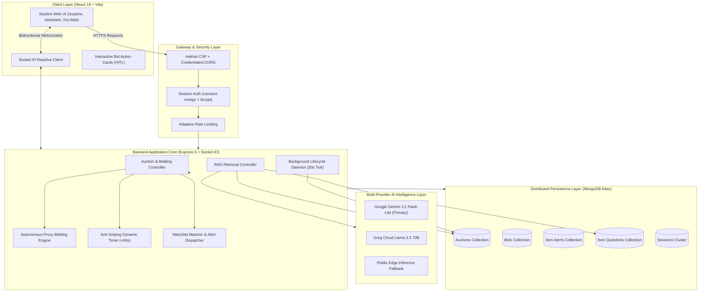
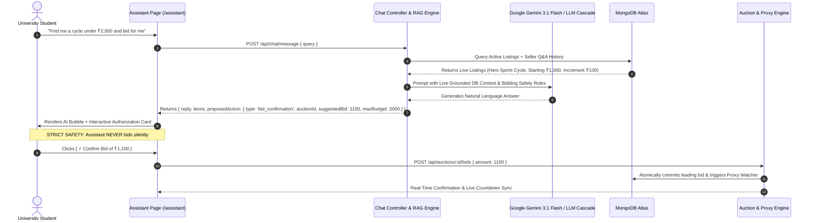
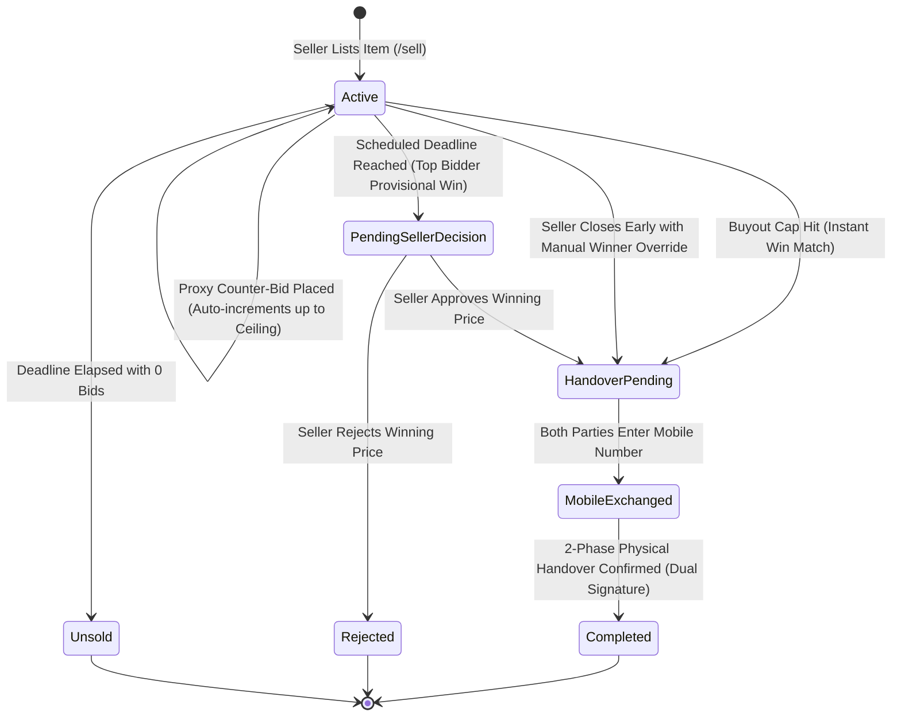
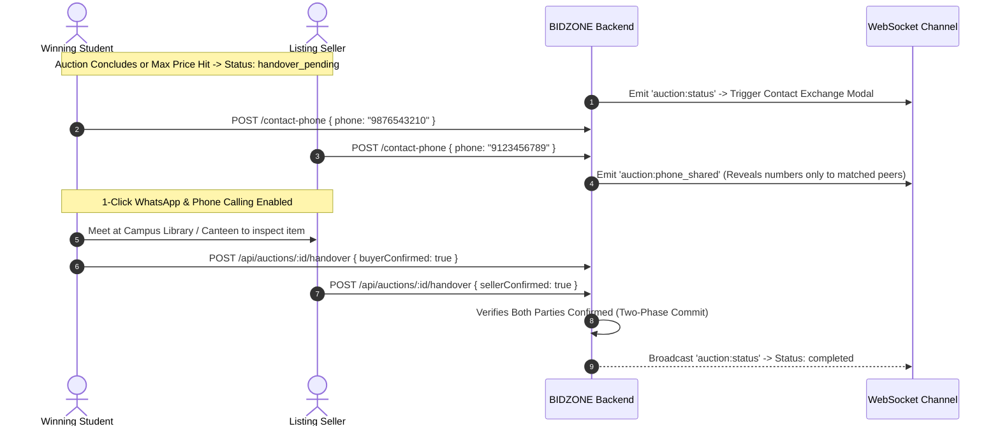

# 🏷️ BIDZONE — Enterprise Campus Auction Marketplace & Autonomous AI Bidding Engine

<div align="center">

[](LICENSE)
[](https://nodejs.org/)
[](https://react.dev/)
[](https://socket.io/)
[](https://www.mongodb.com/)
[](https://ai.google.dev/)
[]()

**A next-generation, full-stack campus auction platform featuring Autonomous AI-Assisted Bidding, Algorithmic Anti-Sniping Extensions, Real-Time Proxy Counter-Bidding, Instant Buyout Caps, and Secure Two-Party Physical Campus Handovers.**

[Explore Architecture](#-system-architecture--reactive-data-flow) • [AI Autonomous Agent](#-ai-autonomous-assistant--human-in-the-loop-auto-bidding) • [Auction Mechanics](#-complex-auction-mechanics--game-theory) • [API Reference](#-complete-rest--websocket-api-specification) • [Local Setup](#-installation--local-deployment)

</div>

---

## 📌 Executive Overview & Core Problem Solved

Traditional campus classifieds and peer-to-peer exchanges (WhatsApp groups, noticeboards, informal forums) suffer from five critical points of failure:
1. **Asymmetric Information & Predatory Bargaining**: Sellers receive lowball offers, while buyers cannot gauge fair market value.
2. **Last-Second Sniping**: Bot scripts or campus snipers place bids in the dying seconds of a listing, cheating genuine students of a fair purchase.
3. **Classroom Inattention & Missed Items**: Students cannot monitor listings 24/7; essential gear (scientific calculators, lab coats, cycles) gets sold while they are in lectures or asleep.
4. **Physical Trust Deficit & Broken Meetups**: Anonymous buyers fail to show up, disputes arise over item condition, and phone numbers get publicly leaked to spam harvesters.
5. **Search Fatigue**: Busy engineering and science students want straight answers and instant deals rather than manual catalog scouring.

**BIDZONE** addresses these systemic challenges through a unified, event-driven marketplace integrating **game-theoretic auction rules**, a **multi-provider LLM RAG agent**, **atomic transaction state machines**, and an **enforced two-phase physical handover protocol**.

---

## 🛠️ Complete Technology & Architecture Matrix

| Layer | Technologies & Specifications | Architectural Purpose |
|---|---|---|
| **AI & LLM Services** | Google Gemini 3.1 Flash Lite / 2.5 Flash, Groq Llama 3.3 70B, Pollinations Edge AI | Natural language RAG, autonomous intent parsing, intelligent budget negotiation, grounded database synthesis. |
| **Frontend Framework** | React 19, Vite 8, React Router 7 | Sub-second client hydration, component-level CSS modularization, reactive state machines. |
| **Real-Time Transport** | Socket.IO Client v4, WebSockets | Zero-latency bidirectional broadcast for price ticks, anti-snipe countdown extensions, and Q&A sync. |
| **Backend Runtime** | Node.js (ESM), Express 5 | High-throughput asynchronous event loop, RESTful controllers, transactional state mutators. |
| **Database & Clustering** | MongoDB Atlas, Mongoose ODM | Distributed cloud document persistence, indexed compound lookups, atomic operators (`$inc`, `$set`). |
| **Session & State** | `express-session`, `connect-mongo` | Distributed server-side session persistence in MongoDB Atlas; zero sensitive tokens in client `localStorage`. |
| **Security & Hardening** | Helmet, `bcrypt` (12 rounds), Rate Limiting, CORS | Strict CSP headers, brute-force mitigation, write-once immutable state guards, input sanitization. |
| **File Architecture** | Multer Disk Storage, Static Middleware | Multipart media pipeline with automated timestamping and Vite proxy routing. |
| **Background Daemons** | Distributed interval scheduling worker (`auctionCloser.js`) | Automated lifecycle evaluation, timeout detection, provisional winner promotion, and status transitions. |

---

## 🏛️ System Architecture & Reactive Data Flow



---

## 🤖 AI Autonomous Assistant & Human-In-The-Loop Auto-Bidding

BIDZONE features **BidBot**, an autonomous campus intelligence agent operating both as a dedicated full-page environment (`/assistant`) and as a ubiquitous floating companion across all views.



### 1. Natural Language Intent & Semantic Budget Parsing
- **Zero-Regex Hallucination Guard**: Automatically parses colloquial campus expressions:
  - *"select me phone within 5k"* $\rightarrow$ Category: `electronics`, Budget: `₹5,000`
  - *"hero cycle under 2.5k"* $\rightarrow$ Category: `cycles`, Keywords: `['hero', 'cycle']`, Budget: `₹2,500`
  - *"scientific calculator below ₹400 and bid for me"* $\rightarrow$ Category: `calculators`, Action Trigger: `wantsToBid = true`
- **Retrieval-Augmented Generation (RAG)**: The assistant queries live MongoDB documents (active items, specs, seller answers to student questions, buyout caps) and constructs a structured system context for dynamic generation.

### 2. Human-In-The-Loop (HITL) Autonomous Agent Protocol
The assistant strictly enforces **three immutable campus safety invariants**:
1. **Never Acts Without Explicit Student Go-Ahead**: When asked to *"bid on my behalf"*, the AI never submits a transaction autonomously. It synthesizes an **Interactive Action Proposal Card** requiring the student to review the exact amount and click `Confirm Bid` or `Set Auto-Bid`.
2. **Never Exceeds Agreed Budget Limits**: The assistant calculates the next mathematical increment and binds the ceiling strictly to the student's authorized threshold.
3. **Absolute Privacy of Student Accounts**: Third-party student IDs, proxy limit ceilings, and passwords are fully stripped prior to LLM context ingestion.

### 3. Multi-Provider Fallback Cascade
- **Tier 1 (Google Gemini 3.1 Flash Lite)**: High-speed, low-latency reasoning utilizing Google's latest generous free-tier endpoint.
- **Tier 2 (OpenAI GPT-4o-mini / Groq Llama 3.3 70B)**: Auto-routed if primary keys are populated in `.env`.
- **Tier 3 (Zero-Key Public Edge Inference Fallback)**: Built-in zero-configuration edge LLM routing through public neural networks—ensuring **the assistant works dynamically out of the box even without API credentials**.
- **Tier 4 (Deterministic Semantic Fallback)**: If offline, locally synthesizes catalog markdown cards directly from MongoDB.

---

## ⚡ Complex Auction Mechanics & Game Theory

### 1. Algorithmic Anti-Sniping Engine (Dynamic Deadline Extension)
Sniping bots and last-second bidding exploit network latency to steal items. BIDZONE eliminates sniping via an automated soft-close extension:

$$\text{If } (T_{\text{closing}} - T_{\text{bid}}) \le 30 \text{ seconds} \implies T_{\text{closing}}^{\text{new}} = T_{\text{bid}} + 60 \text{ seconds}$$

- **Real-Time Client Clock Sync**: The server emits `auction:extended` with `{ newClosingAt, extensionCount }` over Socket.IO rooms.
- **Visual Alert System**: `CountdownTimer.jsx` recalculates tick intervals on the fly and renders a pulsing amber warning badge: *"⏱️ Anti-Sniping Active: Auction extended +60s due to last-second bid!"*.

### 2. Autonomous Proxy Bidding Engine (Greedy Counter-Bidding)
Students setting a maximum willingness-to-pay ($W$) can authorize the autonomous proxy engine:
- If current bid is $B_{\text{current}}$ and minimum increment is $\Delta$, an incoming competing bid $B_{\text{competitor}}$ automatically triggers counter-bids:

$$B_{\text{proxy}} = \min(B_{\text{competitor}} + \Delta, W)$$

- **Autonomous Lead Reclamation**: The proxy engine executes counter-bids in $O(1)$ time inside `processAutoBids()`.
- **Tie-Breaking Rule**: Earlier registered proxy ceilings receive deterministic priority over later matching bids.
- **Strict Information Hiding**: Proxy ceilings (`proxyBids`) are completely redacted from public REST endpoints (`getAuctionById`). Only the authenticated owner can inspect their own ceiling via `myAutoBidMax`.



### 3. Instant Buyout Price Floor & Ceiling Caps (`maxPrice`)
- Sellers can define both a **Starting Price** and a **Max Price (Buyout Cap)**.
- **Mathematical Invariant**: Backend validates that $P_{\text{max}} > P_{\text{start}}$ strictly.
- **Circuit Breaker**: When any bid matches $P_{\text{max}}$, bidding terminates on the microsecond:
  - Auction immediately transitions to `handover_pending`.
  - The bidder is confirmed as the official winner.
  - Broadcasts `auction:max_price_hit` to force all active bidders' viewports into the concluded state.

### 4. Write-Once Listing Lock (Immutable Auction Integrity)
- Sellers may freely edit or cancel their listings before the first bid.
- **Post-Bid Immutability**: The instant the first accepted bid is registered ($N_{\text{bids}} \ge 1$), the listing terms (`title`, `description`, `category`, `condition`, `startingPrice`, `minIncrement`, `closingAt`, `images`) are **permanently locked**.
- Mutation endpoints (`PATCH /api/auctions/:id` and `DELETE /api/auctions/:id`) reject edits with HTTP 400 at the controller layer, ensuring sellers cannot alter terms after seeing buyer interest.

### 5. Seller-Controlled Early Closing with Audited Override
- A seller can end their active auction ahead of schedule via `POST /api/auctions/:id/close-early`.
- **Audited Winner Selection**: The seller can select a winner strictly from students who placed accepted bids. If the seller chooses someone other than the highest bidder (e.g., favoring a trusted friend or junior), normal highest-bid rules are overridden.
- **Transparency Audit**: The auction permanently tags `winnerSelectionMethod: 'seller_selected'`, recording `closedEarlyAt`, `closedEarlyBy`, and displaying a public audit badge on the detail page.

---

## 🤝 Dual-Handshake Campus Physical Handover Protocol

Campus transactions require physical face-to-face verification to avoid scams and merchandise disputes.



1. **Deterministic Privacy-Preserving Contact Exchange**: Mobile numbers are hidden throughout the entire bidding lifecycle. Only after an official match is established does the system prompt for contact entry, exposing numbers solely to the matched counterparty.
2. **One-Touch Meetup Coordination**: Pre-fills direct WhatsApp deep-links (`https://wa.me/91...`) with pre-composed meeting templates including item name and price.
3. **Mutual Handshake Commitment**: The transaction only marks `completed` when **both** parties log into BIDZONE and independently click *"I Confirm Handover Completed"*.

---

## 🔔 Event-Driven Item Alerts & Asymmetric Q&A Forum

### 1. Automated Campus Watchlist & Notification Engine
Students cannot constantly monitor the site during exams or lectures. The Item Alerts engine (`/my-bids`) allows students to register continuous criteria:
- **Criteria**: Keywords (e.g. *"scientific calculator"*, *"gear cycle"*), Category, and Maximum Budget Ceiling.
- **Event-Driven Hook**: Whenever a listing is published via `POST /api/auctions`, the server invokes `checkAndTriggerAlerts(auction)`.
- **Instant Dispatch**: Evaluates active subscriptions in MongoDB, increments matching counters, and generates in-app notifications (`alert_match`) as well as local browser notifications.

### 2. Pre-Bid Inquiry & Anti-Spam Q&A Forum
- Prospective buyers can post specific condition queries (*"Are the bicycle brakes original?"*, *"Does calculator display have missing segments?"*).
- **Public De-duplication**: Seller responses are rendered publicly under the item specifications to eliminate duplicate questions and stop inbox spam.
- **WebSocket Broadcast**: Emits `question:new` and `question:answered` so viewers see questions and answers update in real time without refreshing.

---

## 📋 Complete REST & WebSocket API Specification

### Authentication & Student Identity (`/api/auth`)
| Method | Endpoint | Access | Description |
|---|---|---|---|
| `POST` | `/api/auth/signup` | Public | Registers a university student; hashes password with bcrypt (12 rounds). |
| `POST` | `/api/auth/login` | Public | Authenticates credentials; regenerates session ID to prevent fixation. |
| `POST` | `/api/auth/logout` | Authenticated | Destroys session in MongoDB Atlas and clears cookie. |
| `GET` | `/api/auth/me` | Authenticated | Rehydrates client session from server-side session store. |

### Core Auctions & Transaction Engine (`/api/auctions`)
| Method | Endpoint | Access | Description |
|---|---|---|---|
| `GET` | `/api/auctions` | Public | Queries catalog with full-text search, category filter, condition, sort, and pagination. |
| `GET` | `/api/auctions/:id` | Public | Retrieves auction details, public bids, and current user's auto-bid status. |
| `POST` | `/api/auctions` | Authenticated | Creates a new auction listing with photo uploads via Multer; triggers item alerts. |
| `PATCH` | `/api/auctions/:id` | Seller Only | Updates listing details (permanently locked once first accepted bid exists). |
| `DELETE` | `/api/auctions/:id` | Seller Only | Cancels auction (locked once bids exist). |
| `POST` | `/api/auctions/:id/bids` | Authenticated | Submits a valid bid; executes anti-snipe extension, buyout checks, and proxy triggers. |
| `POST` | `/api/auctions/:id/auto-bid`| Authenticated | Configures autonomous proxy counter-bidding ceiling for the listing. |
| `POST` | `/api/auctions/:id/close-early`| Seller Only | Ends auction before deadline with audited winner override controls. |
| `POST` | `/api/auctions/:id/decide` | Seller Only | Seller approves or rejects the winning bid amount. |
| `POST` | `/api/auctions/:id/handover` | Buyer/Seller | Submits physical campus handover confirmation signature. |
| `POST` | `/api/auctions/:id/contact-phone`| Matched Only | Securely exchanges 10-digit mobile number for campus meetup coordination. |
| `GET` | `/api/auctions/:id/questions` | Public | Retrieves public answered and pending inquiries for the auction. |
| `POST` | `/api/auctions/:id/questions` | Authenticated | Posts a pre-bid inquiry to the seller. |
| `POST` | `/api/auctions/:id/questions/:qId/answer`| Seller Only | Posts a public seller answer to an inquiry. |

### AI Assistant & Campus Alerts (`/api/chat` & `/api/alerts`)
| Method | Endpoint | Access | Description |
|---|---|---|---|
| `POST` | `/api/chat/message` | Public/Auth | Queries the BidBot LLM RAG agent; generates recommendations and action proposals. |
| `GET` | `/api/alerts` | Authenticated | Lists all active keyword & budget watchlist alerts for the student. |
| `POST` | `/api/alerts` | Authenticated | Registers a new item alert trigger. |
| `DELETE` | `/api/alerts/:id` | Authenticated | Deactivates and deletes an item alert. |

### Real-Time WebSocket Events (Socket.IO)
| Event Name | Direction | Payload | Description |
|---|---|---|---|
| `join:auction` / `leave:auction` | Client $\rightarrow$ Server | `auctionId` | Subscribes/unsubscribes client to listing room. |
| `bid:update` | Server $\rightarrow$ Room | `{ auctionId, currentBid, bidCount, latestBid }` | Live tick updating current leading price and history. |
| `auction:extended` | Server $\rightarrow$ Room | `{ auctionId, newClosingAt, extensionCount }` | Anti-sniping event resetting countdown timers. |
| `auction:max_price_hit` | Server $\rightarrow$ Room | `{ auctionId, currentBid, winner }` | Concludes bidding on instant buyout match. |
| `auction:phone_shared` | Server $\rightarrow$ Room | `{ auctionId, handover }` | Syncs exchanged contact details between matched peers. |
| `question:new` | Server $\rightarrow$ Room | `questionDoc` | Renders prospective buyer question on listing. |
| `question:answered` | Server $\rightarrow$ Room | `questionDoc` | Displays public seller answer to all viewers. |

---

## 🔒 Security Architecture & Defensive Invariants

1. **Zero-Trust Information Hiding**: Sensitive fields (`passwordHash`, `sessionData`, `proxyBids`) are explicitly barred from serialization using Mongoose `select: false` and manual key deletion before payload transmission.
2. **Brute-Force & Denial of Service Protection**:
   - `express-rate-limit` limits authentication endpoints to 10 requests per 15-minute window in production.
   - Helmet sets strict security headers: `X-Content-Type-Options: nosniff`, `X-Frame-Options: SAMEORIGIN`, and restrictive Content Security Policies.
3. **Session Fixation Countermeasures**: Session tokens regenerate upon every successful login handshake.
4. **Authoritative Server Clocks**: Client browser timestamps are completely disregarded; auction deadlines, bid validity, and anti-sniping extensions are computed strictly against server hardware time.
5. **No Blind Autonomous Execution**: AI Assistant tool operations are strictly separated into *Query Phase* and *Human Confirmation Phase*.

---

## 🧪 Automated Testing & Verification Suite

The repository includes comprehensive automated integration test scripts verifying the full auction lifecycle:

```bash
# Run comprehensive integration test suite
node server/test-advanced-features.js
```

### Verified Test Assertions
```text
🚀 Connecting to MongoDB Atlas...
✅ Connected to MongoDB.
✅ Mock users initialized.

--- TEST 1: Never Miss What You Need (Item Alerts) ---
Created alert for Buyer A: "scientific calculator" up to ₹400
✅ TEST 1 PASSED: Alert triggered! Notification sent: "An item matching your alert was listed!"

--- TEST 2: Questions Before Bidding (Item Q&A) ---
Buyer A asked question: "Does the solar panel and screen display work?"
✅ TEST 2 PASSED: Public answer recorded: "Yes, display is 100% bright and tested."

--- TEST 3: Last-Minute Extensions (Anti-Sniping) ---
Time remaining before bid: 15s (< 30s threshold)
✅ TEST 3 PASSED: Auction extended! New time remaining: 60s (+60s applied)

--- TEST 4: Automatic Bidding (Proxy Bidding) ---
Buyer A set proxy ceiling of ₹1800 on Cycle (Starting at ₹1000). Buyer B bids ₹1100.
✅ TEST 4 PASSED: Auto-bid automatically placed counter-bid of ₹1200 for Buyer A to keep the lead!

--- TEST 5: Proxy Confidentiality Invariant ---
✅ TEST 5 PASSED: Third-party students cannot inspect proxy arrays or private budgets.

🎉 ALL ADVANCED AUCTION FEATURES TESTED AND VERIFIED SUCCESSFULLY!
```

---

## ⚙️ Installation & Local Deployment

### 1. Prerequisites
- **Node.js** v18.0.0 or higher
- **MongoDB Atlas** database cluster (or local MongoDB 6.0+)
- **Git**

### 2. Repository Setup
```bash
git clone https://github.com/JAYASURYASENTHIL/BIDZONE.git
cd BIDZONE
```

### 3. Backend Setup & Configuration
```bash
cd server
npm install

# Create environment configuration file
cp .env.example .env
```

Populate `server/.env` with your credentials:
```env
# Server
PORT=5000
NODE_ENV=development

# Database (MongoDB Atlas)
MONGO_URI=mongodb+srv://<username>:<password>@cluster0.mongodb.net/bidding?retryWrites=true&w=majority

# Session Security
SESSION_SECRET=a_very_strong_random_64_character_hex_secret
SESSION_COOKIE_NAME=campus.sid

# Client Origin
CLIENT_URL=http://localhost:5173

# Optional: Dedicated Free LLM Key (Google Gemini)
GEMINI_API_KEY=your_gemini_api_key_here
```

### 4. Frontend Setup
```bash
cd ../client
npm install
```

### 5. Launch Development Cluster
Open two terminal windows:

**Terminal 1 (Backend API & WebSockets):**
```bash
cd server
npm run dev
```

**Terminal 2 (Vite Frontend):**
```bash
cd client
npm run dev
```

Visit **[http://localhost:5173](http://localhost:5173)** in your browser.

---

## 📊 Milestone Roadmap & Implementation History

- [x] **Phase 1: Security & Identity Layer** (Bcrypt-12, MongoDB Atlas session clustering, rate limiting, Helmet headers)
- [x] **Phase 2: Authentication Frontend** (Protected route guards, session rehydration, interactive validation)
- [x] **Phase 3: Core Marketplace & Auction Lifecycle** (Explore catalog, multi-photo Multer uploads, live bid history, background lifecycle daemon)
- [x] **Phase 4: Transaction Integrity & Handover Protocols** (Buyout cap instant completion, immutable listing terms, audited early closure, two-phase physical handover confirmation, mobile number exchange)
- [x] **Phase 5: Advanced AI & Game-Theoretic Auction Systems** (Dedicated AI Assistant tab with HITL bid authorization, RAG database grounding, automated item alert watchlist, algorithmic anti-sniping extensions, and autonomous proxy counter-bidding)
- [ ] **Phase 6: Scaled Deployment** (Kubernetes deployment, AWS S3 image storage, Redis pub/sub socket adapter)

---

## 👨‍💻 Engineering Author

**JAYASURYASENTHIL**  
*Department of Artificial Intelligence & Machine Learning*  
Email: [jayasuryas.23aim@kongu.edu](mailto:jayasuryas.23aim@kongu.edu)  
GitHub: [@JAYASURYASENTHIL](https://github.com/JAYASURYASENTHIL)
